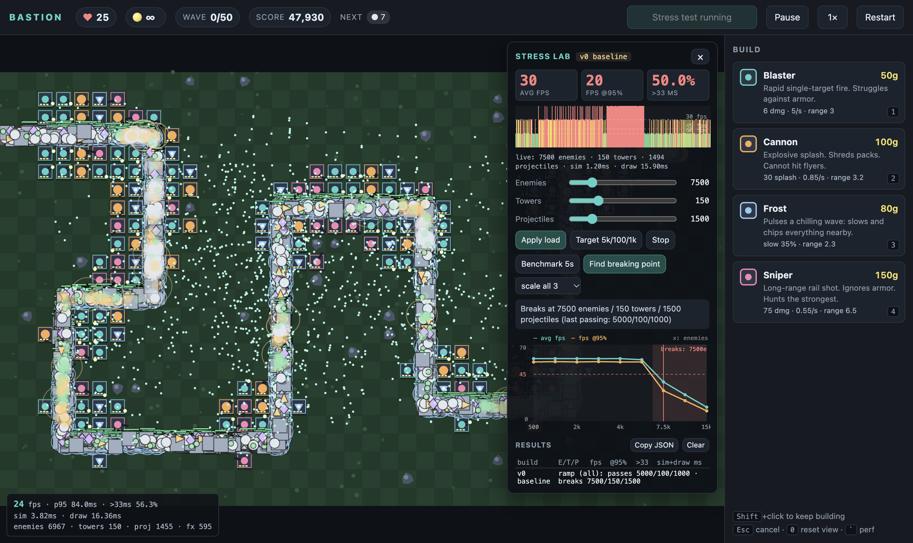

# Performance numbers

All numbers come from `scripts/bench.mjs`, which drives the in-game Stress Lab in a real
(headed) Chrome window. Raw JSON for each run is in `bench/results/`.

**Machine:** Apple M5, Chrome 156, ANGLE/Metal, 1403×836 CSS px at 2× DPR, 60 Hz.
**Pass criteria** (from the brief): ≥ 45 fps for 95% of frames **and** < 5% of frames over 33 ms.
**Ramp:** all three loads scale together from 10% to 800% of the target (5,000 enemies / 100 towers /
1,000 projectiles). Each step settles for 1 s, then records 3 s of real frame times.

Two settings:
- **native** — the M5 at full speed.
- **4× CPU** — Chrome DevTools CPU throttling at 4×, the usual stand-in for a mid-range laptop.
  This is the headline setting, because the M5 hides problems a typical player would hit.

## Baseline (v0) — where the first implementation breaks

| Setting | Last passing load (E/T/P) | Breaks at (E/T/P) | At target 5k/100/1k: fps@95% · sim · draw |
|---|---|---|---|
| native | 10,000 / 200 / 2,000 | 15,000 / 300 / 3,000 | 59.5 · 0.30 ms · 2.49 ms |
| 4× CPU | 5,000 / 100 / 1,000 | **7,500 / 150 / 1,500** | 56.8 · 1.02 ms · 10.02 ms |

### Full ramp, 4× CPU
| Enemies | Towers | Projectiles | avg fps | fps @95% | >33 ms | sim ms | draw ms | |
|---:|---:|---:|---:|---:|---:|---:|---:|---|
| 500 | 10 | 100 | 60.0 | 56.8 | 0.0% | 0.05 | 1.01 | pass |
| 1,000 | 20 | 200 | 60.0 | 56.8 | 0.0% | 0.07 | 1.85 | pass |
| 2,000 | 40 | 400 | 60.0 | 56.8 | 0.0% | 0.22 | 3.86 | pass |
| 3,000 | 60 | 600 | 60.0 | 57.1 | 0.0% | 0.38 | 5.83 | pass |
| 4,000 | 80 | 800 | 60.0 | 56.8 | 0.0% | 0.60 | 7.61 | pass |
| 5,000 | 100 | 1,000 | 60.0 | 56.8 | 0.0% | 1.02 | 10.02 | pass |
| 7,500 | 150 | 1,500 | 40.7 | 29.2 | 10.5% | 3.09 | 15.05 | **FAIL** |
| 10,000 | 200 | 2,000 | 29.2 | 20.0 | 43.8% | 6.25 | 19.73 | FAIL |
| 15,000 | 300 | 3,000 | 15.7 | 12.0 | 98.0% | 22.01 | 37.76 | FAIL |
| 20,000 | 400 | 4,000 | 8.5 | 6.6 | 100.0% | 64.84 | 48.73 | FAIL |

### Full ramp, native
| Enemies | Towers | Projectiles | avg fps | fps @95% | >33 ms | sim ms | draw ms | |
|---:|---:|---:|---:|---:|---:|---:|---:|---|
| 5,000 | 100 | 1,000 | 60.0 | 59.5 | 0.0% | 0.30 | 2.49 | pass |
| 7,500 | 150 | 1,500 | 60.0 | 59.5 | 0.0% | 0.51 | 3.50 | pass |
| 10,000 | 200 | 2,000 | 60.0 | 59.5 | 0.0% | 0.79 | 4.78 | pass |
| 15,000 | 300 | 3,000 | 47.7 | 29.9 | 2.8% | 2.35 | 16.86 | **FAIL** |
| 20,000 | 400 | 4,000 | 33.5 | 20.0 | 14.9% | 5.58 | 21.14 | FAIL |
| 30,000 | 600 | 6,000 | 17.0 | 15.0 | 92.3% | 33.53 | 23.84 | FAIL |
| 40,000 | 600 | 8,000 | 5.7 | 4.6 | 100.0% | 117.34 | 27.69 | FAIL |

### What the baseline numbers say
- **Drawing dominates first.** At the target load, draw costs about 10× more than simulation
  (10.0 ms vs 1.0 ms at 4× CPU). Every enemy gets its own `beginPath`, fill-style change, fill,
  stroke and health bar.
- **The simulation then blows up quadratically.** From 20k to 40k enemies, sim time goes from
  5.6 ms to 117 ms: tower target search and splash are O(towers × enemies), and `filter()`
  reallocates arrays every step.
- `sim`/`draw` count only JavaScript time. GPU raster time shows up in the frame times
  instead, which is why fps can drop even when sim + draw < 16 ms.

## Optimizations

Each optimization is a runtime switch (Stress Lab panel, the `G` hotkey, or `?opt=render:webgl`),
so before and after are measured on the same build. "Before" re-runs the previous configuration
in the same session.

| # | Optimization | Breaks at, 4× CPU (before → after) | Breaks at, native (before → after) | Draw ms at 5k/100/1k, 4× CPU |
|---|---|---|---|---|
| 1 | WebGL2 instanced entity renderer | 7,500 → **15,000** enemies | 15,000 → **30,000** enemies | 10.11 → **2.47** |
| 2 | Spatial hash grid for range queries | 15,000 → **20,000** enemies | 30,000 → **> 40,000** (passes the whole ramp) | sim at 30k: 395 → **23** ms/frame |
| 3 | Allocation-free sim: cached path segment, pools, in-place compaction, no hidden allocations | 20,000 → **30,000** enemies | > 40,000 (frame work at 40k: 8.3 → 7.0 ms) | sim per step at 40k (Node): 6.60 → **3.07** ms; GCs 92 → 11 |

The table's last column changes with each row, because each optimization targets a different bottleneck.

### 1 · Entity rendering: what was tried

All runs: 4× CPU, same build (`?baseline&opt=render:<mode>`), ramp over all three loads.

| Renderer | Idea | Last passing | Breaks at | JS draw ms at 5k | Verdict |
|---|---|---|---|---:|---|
| `naive` | `beginPath`/`arc`/`fill`/`stroke` per enemy | 5,000 | 7,500 | 10.11 | baseline |
| `paths` | one path per enemy type, one fill + one stroke | 3,000 | **4,000** | 13.85 | ✗ slower |
| `sprites` | pre-rendered sprite per type, `drawImage` per enemy | 4,000 | **5,000** | 8.56 | ✗ slower |
| `sprites` + `ImageBitmap` | same, GPU-resident sources | — | — | 8.94 (bench at 5k: 44.7 avg fps) | ✗ no change |
| **`webgl`** | **one typed-array upload + one instanced draw call** | **10,000** | **15,000** | **2.47** | ✓ kept |

Why the Canvas 2D "optimizations" lost:
- Chrome's Canvas 2D runs on Skia, which already merges consecutive anti-aliased circle draws
  into one GPU op, even across fill colors. So the naive renderer was GPU-batched underneath.
- One giant path with thousands of sub-paths has to be tessellated as a whole, which costs more
  than many small analytic circles. `drawImage` from many source images cannot be merged the same way.
- What actually limits Canvas 2D is the **main-thread cost per API call** (about 2 µs under 4× throttling).
  Any Canvas 2D strategy still makes thousands of calls per frame. WebGL instancing replaces all
  of them with one `bufferSubData` and one `drawArraysInstanced`.

Full ramps: `bench/results/opt1-render-*.json`.

### After optimization 1 — full ramp, 4× CPU
| Enemies | Towers | Projectiles | avg fps | fps @95% | >33 ms | sim ms | draw ms | |
|---:|---:|---:|---:|---:|---:|---:|---:|---|
| 5,000 | 100 | 1,000 | 60.0 | 56.8 | 0.0% | 1.08 | 2.47 | pass |
| 7,500 | 150 | 1,500 | 60.0 | 57.1 | 0.0% | 1.88 | 3.26 | pass |
| 10,000 | 200 | 2,000 | 60.0 | 57.1 | 0.0% | 2.99 | 4.48 | pass |
| 15,000 | 300 | 3,000 | 53.4 | 29.9 | 6.2% | 7.01 | 6.77 | **FAIL** |
| 20,000 | 400 | 4,000 | 30.0 | 15.0 | 39.8% | 21.32 | 9.41 | FAIL |
| 30,000 | 600 | 6,000 | 2.1 | 1.7 | 100.0% | 472.21 | 13.70 | FAIL |

The bottleneck has moved: from 15k enemies up, **simulation** time passes draw time and then
explodes (472 ms at 30k). That is the O(towers × enemies) target search and splash, and it is next.

### 2 · Spatial hash grid

**What changed.** [src/grid.js](src/grid.js) buckets every enemy into 80 px cells (2 tiles), once
per simulation step.
- The rebuild is a counting sort into flat `Int32Array`s (count, then prefix-sum, then fill).
  It is O(n) and allocates nothing after warm-up.
- Tower targeting, Cannon splash and Frost pulses ask `game.candidates(x, y, r)` for the
  enemies in the cells their range touches, instead of scanning all of them.
- The exact distance checks stay, so results are unchanged.

**Correctness.** `node scripts/check-grid.mjs`:
- 8,000 random range queries (including off-map enemies and radii up to 9 tiles) return
  exactly the same sets as a full scan: **0 mismatches**.
- A full 50-wave bot game plays out the same with the grid off and on (won, 15 lives, 6,528 kills).

**Results**, 4× CPU, renderer = webgl in both runs (`bench/results/opt2-grid-*.json`):

| Enemies | Towers | Projectiles | grid off: fps@95% · sim ms | grid on: fps@95% · sim ms |
|---:|---:|---:|---|---|
| 5,000 | 100 | 1,000 | 57.1 · 0.97 | 57.1 · 0.72 |
| 10,000 | 200 | 2,000 | 56.8 · 2.82 | 56.8 · 1.99 |
| 15,000 | 300 | 3,000 | 30.0 · 6.42 **FAIL** | 57.1 · 3.87 pass |
| 20,000 | 400 | 4,000 | 19.7 · 13.63 FAIL | 29.9 · 8.08 **FAIL** |
| 30,000 | 600 | 6,000 | 2.1 · 395.53 FAIL | 15.1 · 23.46 FAIL |

At native speed, with the grid on, every ramp step passes, up to 40,000 / 600 / 8,000
(59.2 fps @95%, sim 3.95 ms, draw 4.37 ms).

**What `scripts/profile-sim.mjs` says is left** (Node, per sim step, grid on):

| Load | Step | Enemy movement | Towers | `filter()` cleanup | Projectiles |
|---|---:|---:|---:|---:|---:|
| 20k / 400 / 4k | 1.66 ms | 44% | 37% | 12% | 6% |

- At 40k / 600 / 8k a step takes 5.35 ms (15.60 ms with the grid off).
- **Enemy movement** is now the biggest phase. Each enemy walks the road's segment list every
  step to find its position.
- **Garbage collection**: 89 GCs in 360 steps at 40k, from `filter()` copying the entity arrays and
  from a new object per projectile and effect.
- The browser's "sim ms per frame" grows faster than this past the breaking point. Slow frames
  make the fixed-timestep loop run 2–4 steps per frame to keep game time correct.
- Note: on a normal game (~100 enemies) the grid costs about 1.7 µs more per step than scanning.
  That is irrelevant, so it stays on.

### 3 · Allocation-free simulation

Three things, found by profiling rather than guessing:

1. **Hidden allocations** (always on; they were bugs). V8's sampling heap profiler, with collected
   objects included, showed ~1.9 GB allocated over 360 steps at 40k:
   - The grid's candidate list was a JS array cleared with `length = 0`. That frees its backing
     store, so every query regrew it with `push`. It is now a reused `Int32Array` of indices.
   - `Math.hypot` allocated. It is replaced with `Math.sqrt(dx*dx + dy*dy)`.
   - `for…of` in hot loops created iterator objects. They are now indexed loops.
   - After this: ~55 MB over the same run, most of it the initial 40k enemies.
2. **`path`: scan → cached.** Each enemy remembers its road segment and only steps forward,
   instead of searching the segment list every step. Movement at 40k: 1.67 → 1.10 ms per step.
3. **`alloc`: filter → pooled.**
   - Dead enemies, projectiles and effects are compacted out of their arrays in place, keeping
     order, and pushed onto free lists. Spawns reuse them.
   - Every entity kind has one fixed object shape, so recycled objects keep one hidden class.
   - Projectiles remember their target's `id`, so a recycled enemy object is never mistaken for
     the enemy they were fired at.

**Correctness.** `node scripts/check-sim.mjs` runs two games in lockstep from the same seed:
original `path`/`alloc` vs optimized. It compares the full state (every enemy's position, HP and
slow; projectiles; gold; lives; kills) after every step. Results:
- **Bit-identical** for 90,000 steps of a bot game (through wave 32).
- **Bit-identical** for 1,800 steps of a 3,000-enemy stress loop.

**Per-step cost at 40k / 600 / 8k** (Node, `scripts/profile-sim.mjs`, 360 steps, `--trace-gc`):

| Configuration | ms / step | Movement | Cleanup | GC scavenges |
|---|---:|---:|---:|---:|
| Before (end of optimization 2) | 6.60 | 2.00 | 0.88 | 92 |
| + hidden allocations removed | 4.79 | 1.67 | 0.60 | 25 |
| + `path: cached` | 4.14 | 1.10 | 0.60 | 25 |
| + `alloc: pooled` | **3.07** | 1.12 | **0.15** | **11** |

**Browser, 4× CPU, renderer = webgl and grid = on in both runs** (`bench/results/opt3-*.json`).
"Before" here is `path:scan,alloc:filter` on the current build, so the hidden-allocation fixes
are in both runs.

| Enemies | Towers | Projectiles | path+alloc off: fps@95% · sim · draw | all on: fps@95% · sim · draw |
|---:|---:|---:|---|---|
| 15,000 | 300 | 3,000 | 56.8 · 3.41 · 6.56 | 56.8 · 2.67 · 6.71 |
| 20,000 | 400 | 4,000 | 30.1 · 6.52 · 9.52 **FAIL** | 56.8 · 4.46 · 9.37 pass |
| 30,000 | 600 | 6,000 | 14.9 · 27.84 · 14.56 FAIL | 15.0 · 16.39 · 14.90 **FAIL** |
| 40,000 | 600 | 8,000 | 6.7 · 96.95 · 20.00 FAIL | 12.1 · 25.91 · 16.48 FAIL |

**Memory over a complete 50-wave game** (`node --expose-gc scripts/check-memory.mjs`, heap after a forced GC):

| Wave | start | 10 | 20 | 30 | 40 | 50 |
|---|---:|---:|---:|---:|---:|---:|
| Heap MB | 3.95 | 4.21 | 4.33 | 4.35 | 4.41 | 4.45 |

The heap stays flat. The +0.5 MB is the 240 towers the bot builds and the pools sized to peak load.

**What is left.** At 20k, draw (9.4 ms) is twice the sim time (4.5 ms), and most of it is now on
the Canvas 2D layers:
- the ground is redrawn tile by tile every frame;
- ~400 towers, each drawn with its own calls;
- thousands of short-lived death effects, each with its own `globalAlpha` and `arc`.
